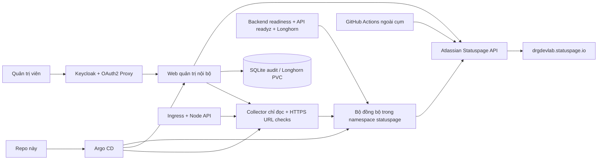

# DRG DevLab Statuspage Platform

- Public status: https://drgdevlab.statuspage.io
- Website: https://drgdevlab.com/
- Internal administration: https://status-admin.apps.drgdevlab.com
- Kubernetes namespace: `statuspage`
- GitOps Application: `argocd/statuspage-platform`

Repo chứa toàn bộ mã đồng bộ, web quản trị, Kubernetes/Argo CD manifests, CI,
external watchdog và hướng dẫn vận hành. Không chứa API key hay mật khẩu.

## Kiến trúc



| Phần | Nguồn quản lý | Cách cập nhật |
|---|---|---|
| Tên trang, link website, tên/mô tả/nhóm component, biểu đồ uptime component | Statuspage | Web quản trị nội bộ |
| Trạng thái sức khỏe và hai metric tổng hợp | Check thực tế | Sync mỗi 60 giây; lỗi 3 vòng, phục hồi 2 vòng |
| Trạng thái truy cập Internet và độ mới của sync | GitHub-hosted runner | Phút 17 và 47; có thể trễ |
| Inventory, duyệt public, check, ID component, deployment | Git + collector | Discovery mỗi 60 giây; policy được review qua Git |
| Incident/maintenance, subscriber và notification | Atlassian | Link trực tiếp từ web quản trị |

Kubernetes Control Plane kiểm tra trực tiếp API `/readyz` với TLS CA của cluster;
Persistent Storage đọc health của volume và storage node từ Longhorn API.
Hai check này không phụ thuộc Prometheus. Check control plane không đo readiness
của từng worker. Collector đọc Ready/pressure/heartbeat của mỗi Node riêng; xem [runbook](docs/OPERATIONS.md) để biết phạm vi kiểm tra.

`showcase` điều khiển lịch sử uptime của component; không ẩn component khỏi public
page. Web nội bộ không tự ý xóa component đang được monitor, sửa check URL hoặc
thay trạng thái sức khỏe. Các thay đổi giao diện không bị sync ghi đè.

## Sử dụng

1. Mở trang quản trị, đăng nhập Keycloak realm `kubernetes` bằng tài khoản thuộc
   nhóm `/k8s-cluster-admins`.
2. Chỉnh thông tin trang hoặc component, kiểm tra trước khi bấm xuất bản.
3. Mở public page để xem kết quả. Lịch sử thao tác nằm trong trang quản trị.
4. Tạo incident và maintenance trong Atlassian theo link trong giao diện;
   quyết định notification tại đó. Sync tôn trọng incident/maintenance đang mở.

## Cấu trúc

- `collector/`: discovery Ingress/Node chỉ đọc, probe URL và inventory SQLite giữ tài nguyên mất.
- `statuspage-sync/`: Python stdlib check engine, cấu hình check, explicit provisioner.
- `admin/`: Python stdlib API, HTML/CSS/JS, OAuth2 Proxy sidecar và PVC.
- `deploy/`: production Kustomize; `deploy/staging/` tắt writer và heartbeat để chuyển cụm an toàn.
- `argocd/`: Application bootstrap chuẩn.
- `scripts/`: bootstrap Keycloak client/Secret và deploy key Argo.
- `.github/workflows/`: tests và watchdog ngoài cụm.
- `docs/OPERATIONS.md`: thao tác vận hành, backup, quyền, khôi phục.
- `docs/IMPLEMENTATION.md`: trình tự thực hiện và bằng chứng nghiệm thu.
- `docs/statuspage/`: kế hoạch và bằng chứng giai đoạn thay portal ban đầu.

## Kiểm tra local

```bash
kubectl kustomize deploy > /tmp/statuspage.yaml
kubectl kustomize deploy/staging > /tmp/statuspage-staging.yaml
# Khi người dùng cho phép chạy local tests:
python3 -m unittest discover -s tests
node --check admin/app.js
```

Bộ test có sẵn trong `tests/`; chỉ chạy khi người dùng yêu cầu. CI tự động render manifests; unit tests là tùy chọn workflow_dispatch.

Xem [runbook](docs/OPERATIONS.md) để bootstrap môi trường. Không chạy lại
`provision.py --apply` như một bước deploy thường xuyên: đây là công cụ seed ban
đầu, có thể ghi đè tên/mô tả/nhóm đã sửa trong web quản trị.

## Discovery và công bố

Admin hiển thị inventory nội bộ, canonical URL, alias/endpoint phụ, loại check,
nguồn và lần quan sát, lý do status, public approval và component ID. Không tự
công bố Ingress/node mới. Policy tại `collector/policy.json` giữ phạm vi host,
quy tắc include/exclude, override và ID; component metadata tiếp tục thuộc admin.
Jenkins được người dùng duyệt công bố, kèm URL/logo; GET root hiện403, logo200
chỉ là tài nguyên tĩnh. Ba node có mapping được duyệt nhưng chưa provision ID.
Hạn mức gói live chưa biết: công cụ tạo mới chặn cho tới khi operator xác minh.
Xem quy trình và giới hạn trong [runbook](docs/OPERATIONS.md#discovery-url-và-từng-node).
